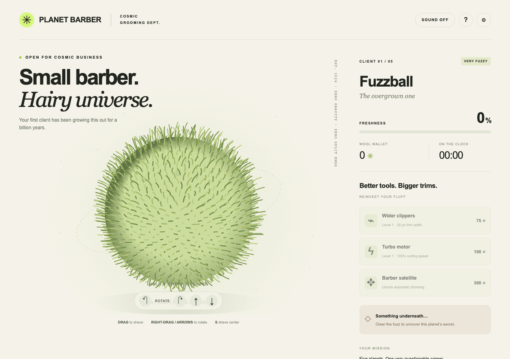

# 🪐 Planet Barber

**A very small barber. A very hairy universe.**

[Play free in your browser](https://planet-barber.a-frantsev116.chatgpt.site/) · [Press kit & real gameplay](https://planet-barber.a-frantsev116.chatgpt.site/press.html)

Give five furry planets a haircut. Sweep the clippers, collect wool, buy upgrades, launch barber satellites and discover what is hiding under the fluff.

- Mouse / touch: hold and drag to shave.
- Rotate: right-drag, arrow keys, two fingers, or the on-screen buttons.
- Keyboard: focus the planet, hold **S** to shave the center and rotate with arrows.
- Progress saves locally. Sound starts muted. No account, ads or purchases.
- Finish the campaign and save a shareable result card.

## Run the downloadable build

Unzip the release archive and run `python3 -m http.server 8000` in the extracted folder, then open http://localhost:8000. Any static web server works. No installation or build step is required for the game. The runtime has no third-party dependencies.

## Feedback / coverage

Please report reproducible bugs in [Issues](https://github.com/Andrew90909/planet-barber/issues) or email [a.frantsev116@gmail.com](mailto:a.frantsev116@gmail.com). Include your browser, device and what happened; avoid personal information or screenshots of private tabs.

You may record, stream and monetize gameplay coverage and use press-kit captures when covering the game. Please link to the game. This does not grant resale or redistribution rights to the game code/artwork.

## Credits

Created for Andrew Frantsev using AI-assisted code and writing. All game visuals and sound are procedural. No third-party character, music or image assets. This is a free first browser release, not a promise of future commercial features.

© 2026 Andrew Frantsev. All rights reserved. No open-source license is granted.
